<picture><source media="(max-width: 700px)" srcset="assets/readme/movil/portada.svg"></picture>

  
  

Estudiante de Ingeniería de Software (VII semestre) en la Universidad Cooperativa de Colombia, Medellín. Construyo **sitios web con HTML, CSS, JavaScript y React**, **apps móviles con Flutter** y **backends con Java, Spring Boot y Python**, siempre en equipo. Busco mi **práctica empresarial en desarrollo full stack o analítica de datos**.

  <a href="https://casarendon.com"><picture><source media="(max-width: 700px)" srcset="assets/readme/movil/proyecto-casa-rendon.svg"></picture></a>
  <a href="https://github.com/geminitodo5-sketch/app-educativa-medellin"><picture><source media="(max-width: 700px)" srcset="assets/readme/movil/proyecto-numi.svg"></picture></a>
  <a href="https://luism7p7.github.io/BlackJack/Casino/public/"><picture><source media="(max-width: 700px)" srcset="assets/readme/movil/proyecto-blackjack.svg"></picture></a>
  <a href="https://github.com/AlexanderM-Code/CineX-Backend"><picture><source media="(max-width: 700px)" srcset="assets/readme/movil/proyecto-cinex.svg"></picture></a>

  
  
  
  <a href="https://github.com/luism7p7/BlackJack"></a>
  
   
  <a href="https://github.com/santiago12R/Computacion-ubicua">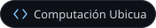</a>
  <a href="https://github.com/santiago12R/examen1"></a>
  <a href="https://github.com/santiago12R/estructura-datos"></a>

<picture><source media="(max-width: 700px)" srcset="assets/readme/movil/trayectoria.svg"></picture>

<picture><source media="(max-width: 700px)" srcset="assets/readme/movil/stack.svg">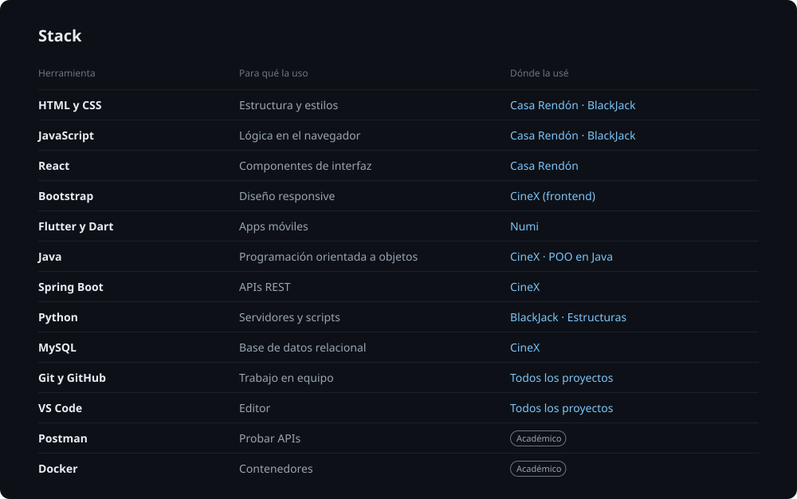</picture>

  
  
  
  <a href="https://www.skills.google/public_profiles/d2cda74b-8293-4ec6-94de-48ceadedb950/badges/23233254"></a>
  

<picture>
  <source media="(max-width: 700px)" srcset="https://raw.githubusercontent.com/santiago12R/santiago12R/output/contribuciones-movil.svg">
  
</picture>

<a href="mailto:santiago.rodriguezj12@gmail.com"><picture><source media="(max-width: 700px)" srcset="assets/readme/movil/cierre.svg">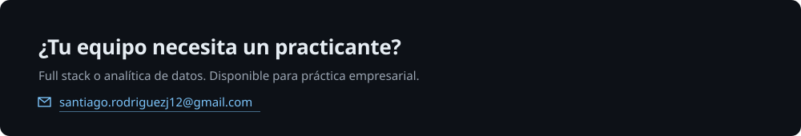</picture></a>
