<!-- 1 · Encabezado -->
<p align="center">
  
</p>

<h3 align="center">Santiago Rodríguez Jiménez</h3>

<p align="center">
  Ingeniería de Software · 7.º semestre<br />
  Universidad Cooperativa de Colombia · Medellín<br />
  Full Stack y Analítica de Datos
</p>

<p align="center">
  
</p>

<!-- 2 · Botones -->
<p align="center">
  <a href="https://github.com/santiago12R/santiago12R/raw/main/Santiago_Rodriguez_CV.pdf"></a>
  <a href="mailto:santiago.rodriguezj12@gmail.com"></a>
</p>

<!-- 3 · Sobre mí -->
Construyo aplicaciones web y móviles en equipo: interfaces con HTML, CSS, JavaScript y React, apps en Flutter y backends en Java con Spring Boot y en Python.
Busco una práctica empresarial en desarrollo full stack o analítica de datos.

---

### Proyectos destacados

#### Casa Rendón
`Cliente real` `En vivo` · 2026 · Equipo

Sitio web de una marca familiar de café y vino de Andes, Antioquia: historia, catálogo y reservas de visitas.

- **Cifra:** 7 secciones; reservas y reseñas llegan directo a WhatsApp.
- **Mi rol:** maquetación en HTML y CSS, interacciones en JavaScript y componentes en React.
- **Stack:** HTML · CSS · JavaScript · React

[Ver sitio](https://casarendon.com) · [Código](https://github.com/AlexanderM-Code/Entre-sorbos---Casa-Rendon)

#### Numi
`En desarrollo` · 2026 · Equipo de 4

App educativa en Flutter para niños de 1.° a 5.° de primaria en zonas rurales de Medellín. Funciona sin internet.

- **Cifra:** 5 materias y 15 actividades interactivas, con un asistente de IA que corre en el celular.
- **Mi rol:** pantallas de la app y ajustes de diseño responsive.
- **Stack:** Flutter · Dart

[Código](https://github.com/geminitodo5-sketch/app-educativa-medellin)

#### BlackJack Royale
`En vivo` · 2025 · Equipo

Casino web con BlackJack contra la máquina, multijugador en tiempo real y banco de fichas.

- **Cifra:** 6 módulos de JavaScript y un servidor de WebSockets en Python.
- **Mi rol:** front-end en HTML, CSS y JavaScript, y servidor multijugador en Python.
- **Stack:** HTML · CSS · JavaScript · Python

[Jugar](https://luism7p7.github.io/BlackJack/Casino/public/) · [Código](https://github.com/luism7p7/BlackJack)

#### CineX
`Académico` · 2025 · Equipo

Sistema para gestionar un cine: películas, salas, funciones y reservas.

- **Cifra:** API REST con 4 entidades, 4 controladores y 8 clases de servicio.
- **Mi rol:** capa de servicios con la lógica de negocio.
- **Stack:** Java · Spring Boot · MySQL · Bootstrap

[Código del backend](https://github.com/AlexanderM-Code/CineX-Backend)

**Otros proyectos:**
[Computación Ubicua](https://github.com/santiago12R/Computacion-ubicua) ·
[POO en Java](https://github.com/santiago12R/examen1) ·
[Estructuras de datos](https://github.com/santiago12R/estructura-datos)

---

### Trayectoria

```txt
2023  ●  Ingreso a Ingeniería de Software
      │  Universidad Cooperativa de Colombia
      │
2024  ●  Estructuras de datos en Python
      │
2025  ●  BlackJack Royale · CineX
      │  Computación Ubicua: robot y sensores
      │
2026  ●  Numi · Casa Rendón (cliente real)
      │
 →    ○  Siguiente: práctica empresarial
      │
2027  ○  Fin de la carrera (previsto)
```

---

### Stack

| Herramienta | Para qué la uso | Proyecto |
| :-- | :-- | :-- |
| HTML y CSS | Estructura y estilos | Casa Rendón, BlackJack |
| JavaScript | Lógica en el navegador | Casa Rendón, BlackJack |
| React | Componentes de interfaz | Casa Rendón |
| Bootstrap | Diseño responsive | CineX (frontend) |
| Flutter y Dart | Apps móviles | Numi |
| Java | Programación orientada a objetos | CineX, POO en Java |
| Spring Boot | APIs REST | CineX |
| Python | Servidores y scripts | BlackJack, Estructuras de datos |
| MySQL | Base de datos relacional | CineX |
| Git y GitHub | Trabajo en equipo | Todos |
| VS Code | Editor | Todos |
| Postman | Probar APIs | Académico |
| Docker | Contenedores | Académico |

---

### Credenciales

Insignias verificables de Google Cloud en Google Skills:

- [Google Cloud Computing Foundations: Cloud Computing Fundamentals](https://www.skills.google/public_profiles/d2cda74b-8293-4ec6-94de-48ceadedb950/badges/23162887)
- [Google Cloud Computing Foundations: Infrastructure in Google Cloud](https://www.skills.google/public_profiles/d2cda74b-8293-4ec6-94de-48ceadedb950/badges/23588126)
- [Implementing Cloud Load Balancing for Compute Engine](https://www.skills.google/public_profiles/d2cda74b-8293-4ec6-94de-48ceadedb950/badges/23233254)
- [Set Up an App Dev Environment on Google Cloud](https://www.skills.google/public_profiles/d2cda74b-8293-4ec6-94de-48ceadedb950/badges/23629566)

---

### Contribuciones

<picture>
  <source media="(prefers-color-scheme: dark)" srcset="https://raw.githubusercontent.com/santiago12R/santiago12R/output/snake-dark.svg" />
  <source media="(prefers-color-scheme: light)" srcset="https://raw.githubusercontent.com/santiago12R/santiago12R/output/snake.svg" />
  
</picture>

---

<p align="center">
  ¿Tienes una vacante de práctica o un proyecto? Escríbeme.<br />
  <a href="mailto:santiago.rodriguezj12@gmail.com">santiago.rodriguezj12@gmail.com</a>
</p>
